# Lab 03: Full Application Modernization

**Objective:** Transform the legacy NetBanking application to Spring Boot + React using the UI Modernization workflow.

---

## Step 1: Select the Java Modernization Workflow

1. Again go to the workflows tab and select **Java Modernization**.

   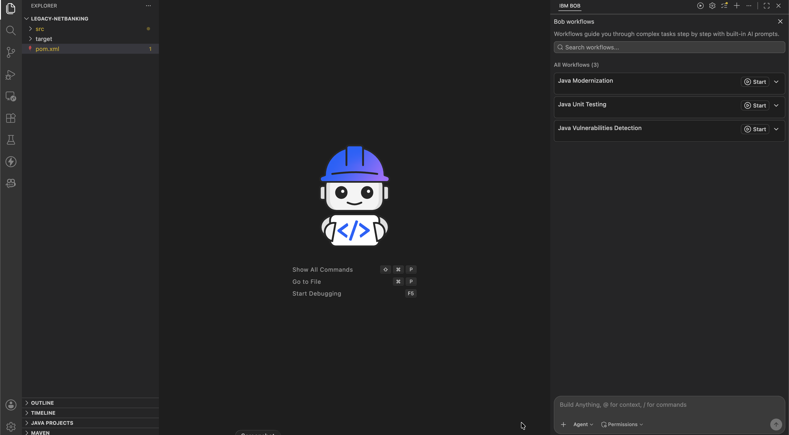

2. Approve the tasks and select **UI Modernization** this time.

   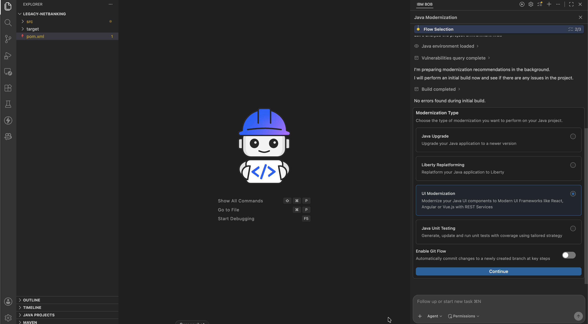

3. Approve the To-do List. Bob will analyze the application to explore modernization options.

   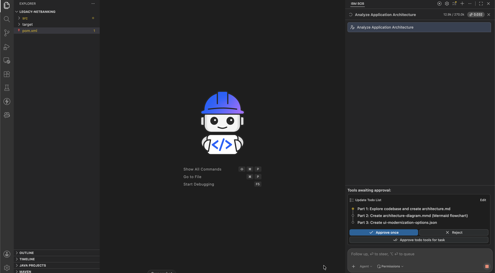

   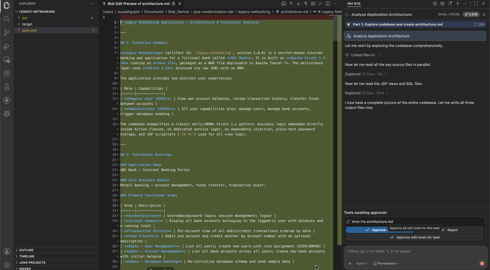

4. Once the analysis is completed, you should see a form. Select both **Frontend Modernization** and **Backend Modernization**.

   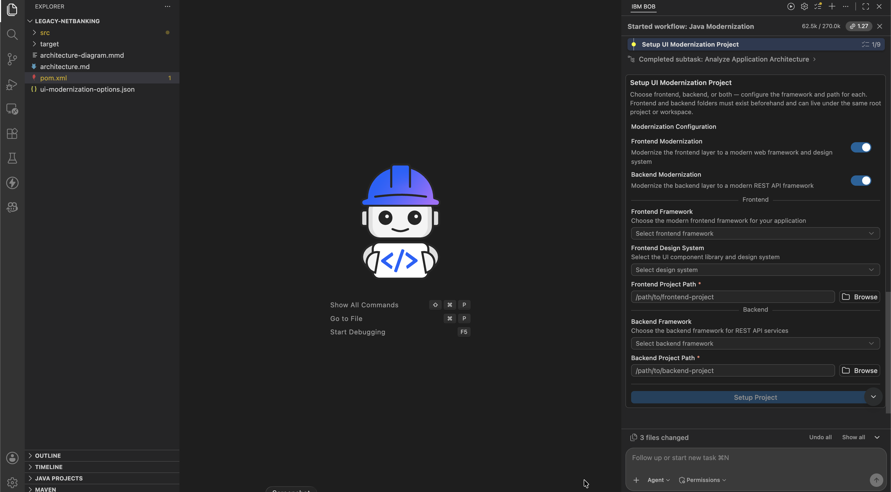

---

## Step 2: Configure the Modernization Options

5. Create the folders to store the frontend and backend code. Open a terminal within the `legacy-netbanking` directory and run the following commands:

   ```bash
   mkdir frontend
   mkdir backend
   ```

6. Configure the modernization options:
   - Select **Frontend Framework: React**.
   - Select **Frontend Design System: Carbon Design System**.
   - Frontend Project Path: Select the `frontend` directory you just created.
   - Select **Backend Framework: Spring Boot**.
   - Backend Project Path: Select the `backend` directory you just created.

   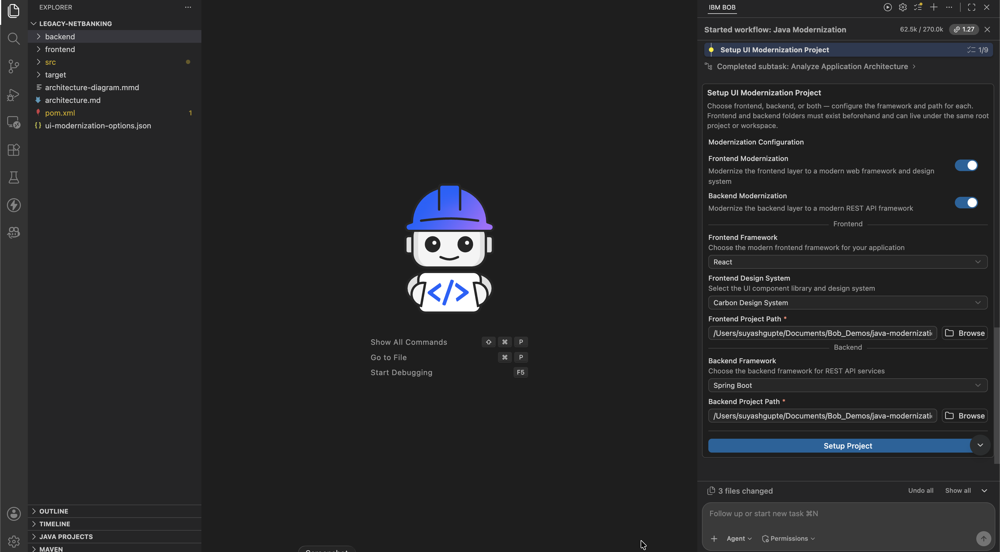

---

## Step 3: Backend Migration

7. Approve the tools to start the Backend Migration.

   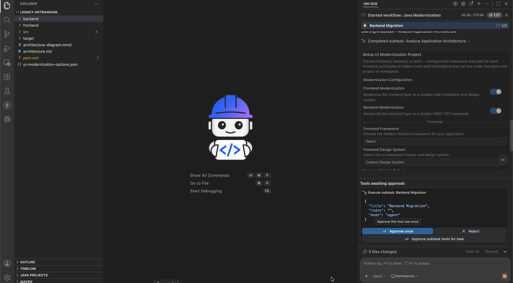

8. Once the Backend Migration is done, run the application using the command in the Bob chat window.

   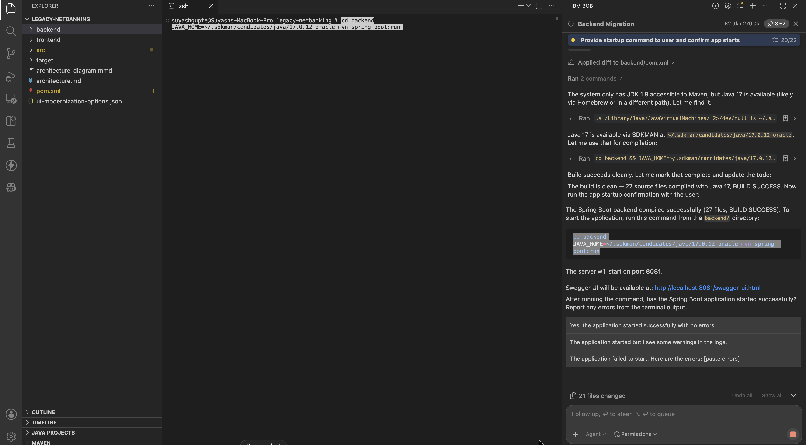

9. You should see a Swagger UI.

   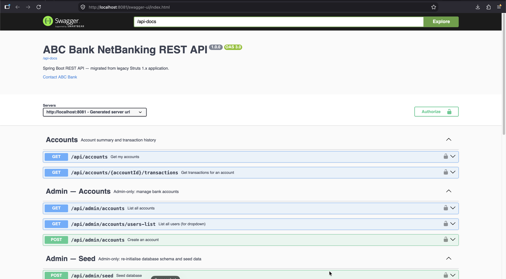

10. Select the **"Yes, everything is working"** option in the Bob chat window. This finishes the Backend Migration.

    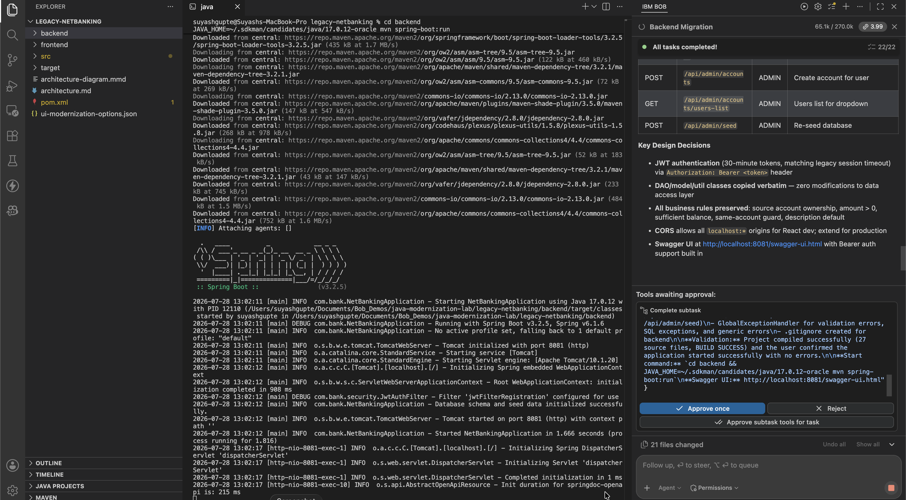

---

## Step 4: Frontend Migration

11. Approve the tool to start the frontend migration.

    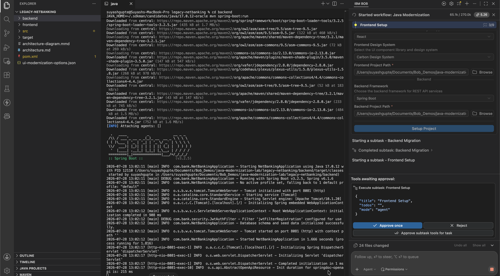

12. Once the Frontend Migration subtask is done, run the application using the command in the Bob chat window.

    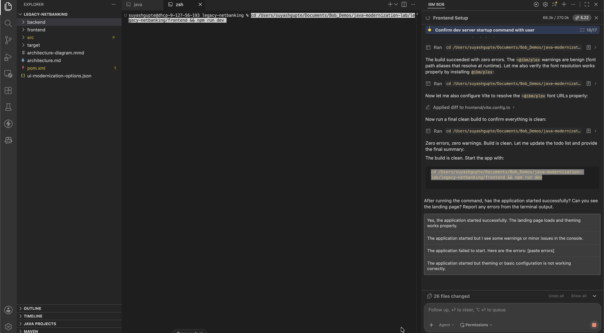

13. The Frontend Migration runs in multiple subtasks. First it creates the structure, integrates with the backend, and validates.

    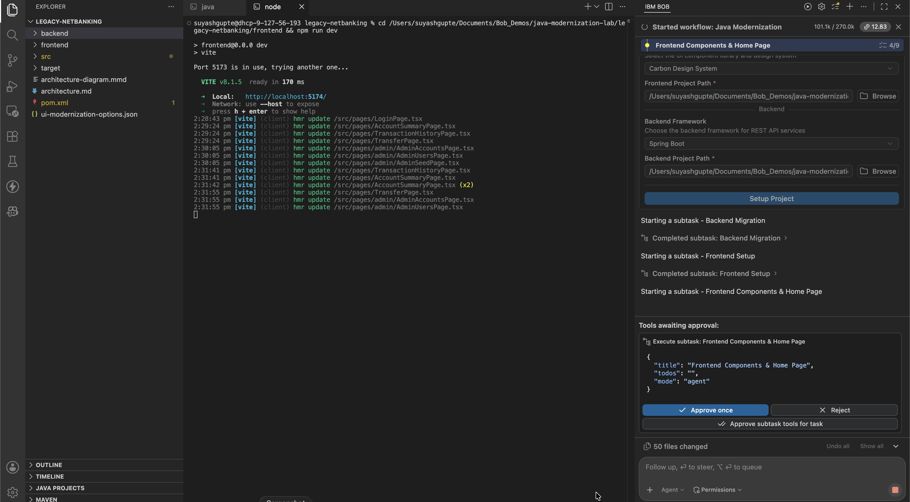

    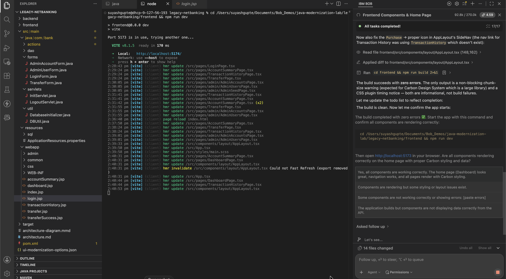

    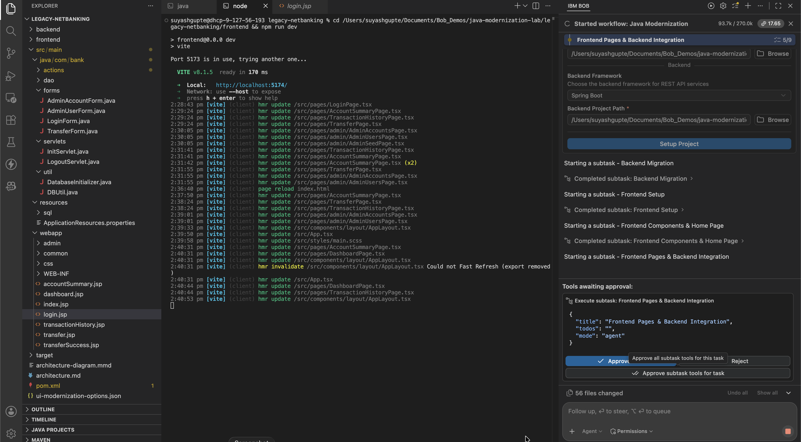

---

## Step 5: Verify the Modernized Application

14. Check the application in the browser. For login use Username: `admin` and Password: `admin123`. Perform a fund transfer to Account: `ACC1001`.

    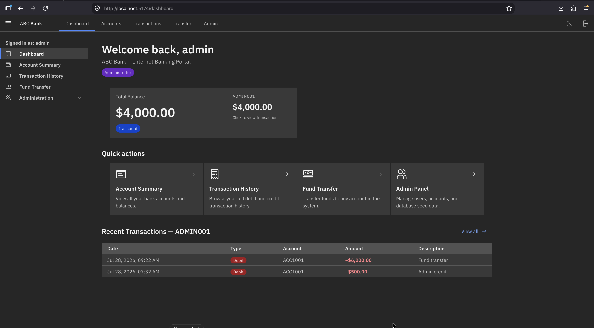

15. The modernization is now complete.

    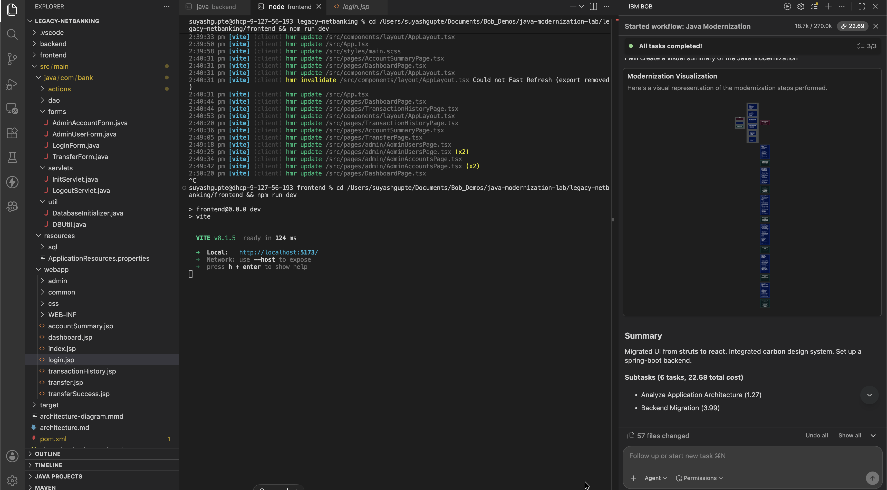
